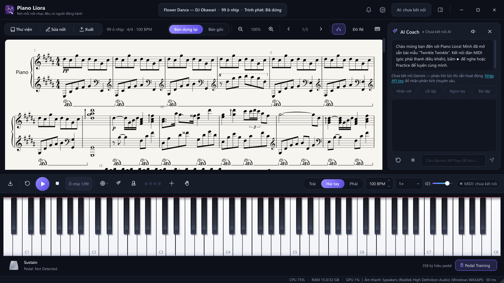
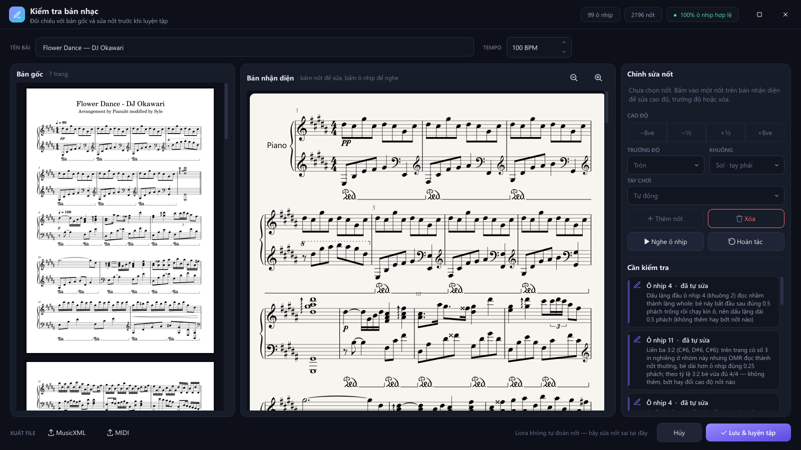
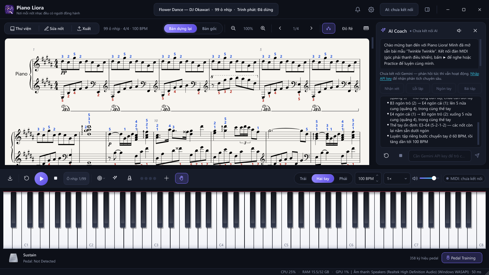
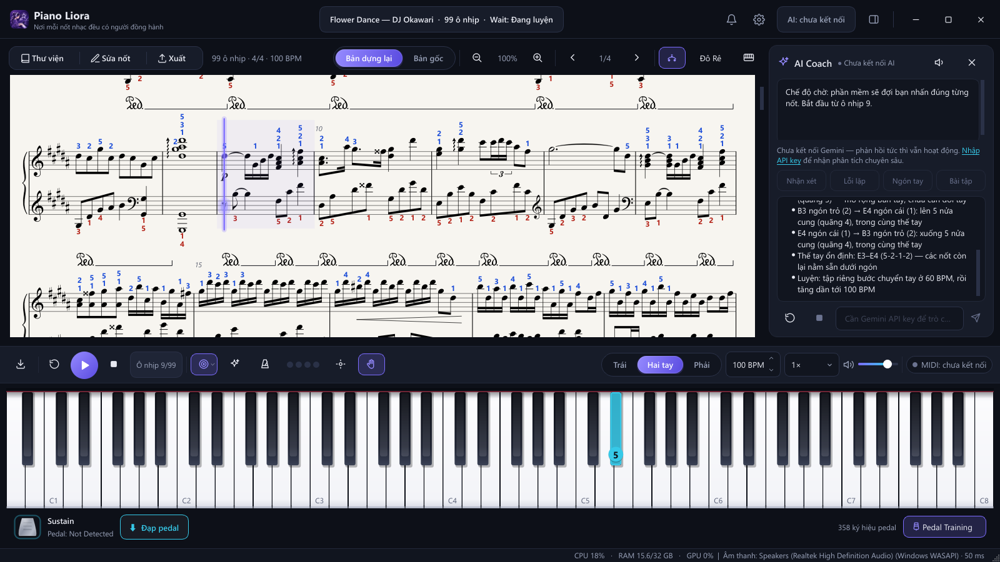
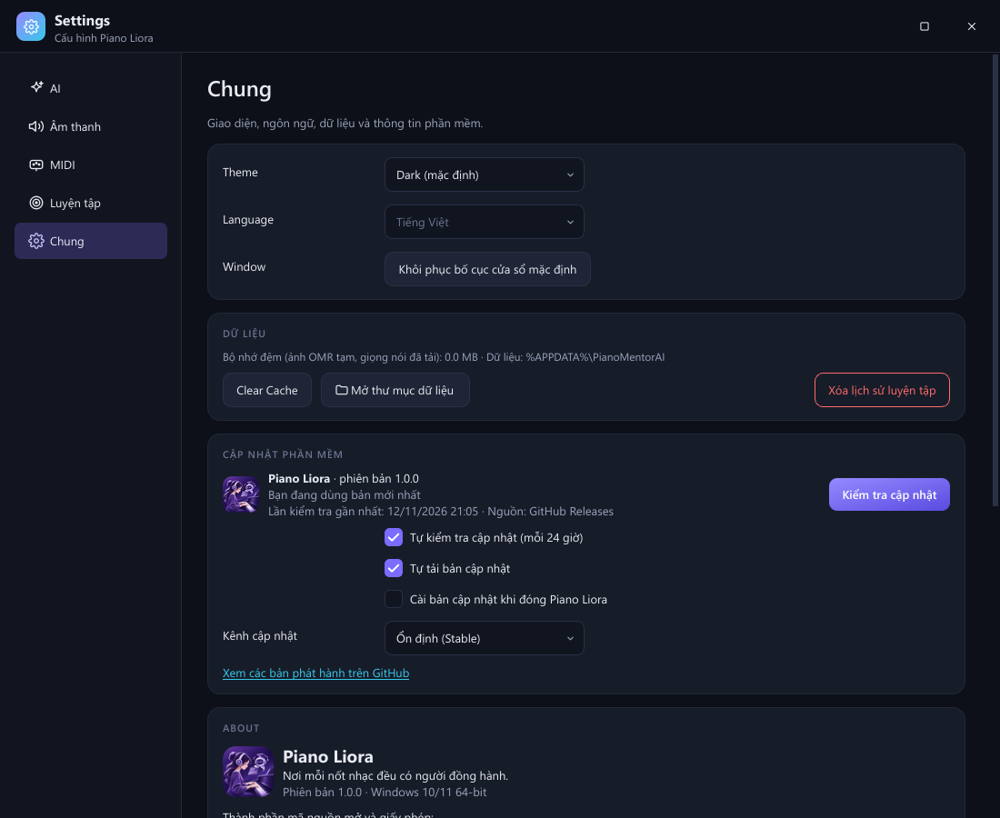

# 🎹 Piano Liora

### Người bạn đồng hành trên từng phím đàn

Piano Liora là ứng dụng học piano trên Windows, kết hợp **nhận diện sheet nhạc**, **luyện tập với đàn MIDI**
và **trợ lý AI hướng dẫn bằng tiếng Việt**.

**[⬇️ Tải Piano Liora](https://github.com/truongquoc-duy/Piano-Liora-Releases/releases/latest)**

> *English: Piano Liora is a Windows piano-learning app — sheet music recognition (PDF / photos), MIDI
> practice with real-time feedback, fingering suggestions and a Vietnamese-speaking AI coach that works
> offline. This repository only distributes the installer through GitHub Releases.*

---

## ✨ Tính năng

### 🎼 Nhận diện bản nhạc (OMR)
- Quét sheet từ **PDF và ảnh chụp** (kể cả ảnh chụp trang giấy hơi nghiêng), nhiều trang một lần.
- Dựng lại cao độ, trường độ, hợp âm, nhiều bè, khóa Sol / khóa Fa và các lần đổi khóa, khóa có số 8.
- Ký hiệu: dấu nối / dấu luyến, pedal, rải hợp âm, 8va, liên ba, dấu lặp và khung lần 1 / lần 2,
  số ngón in sẵn, cách nối thanh móc như bản in.
- **Bản kiểm tra sau khi quét**: bản gốc đặt cạnh bản nhận diện, kiểm tra nhịp theo ký âm (ô lấy đà,
  kết thúc lần 1 rút ngắn…), mỗi chỗ tự sửa đều có lý do và hoàn tác được; bạn sửa nốt trực tiếp.

### 🎹 Bàn phím & phát nhạc
- Bàn phím 88 phím hiển thị nốt đang chơi, nốt cần đánh và số ngón.
- Phát lại bản nhạc kèm pedal; con trỏ chạy theo nhạc trên sheet.
- Kết nối **đàn MIDI** qua USB; có thể phát âm thanh qua loa của chính cây đàn (đàn có cổng âm thanh USB hoặc
  Bluetooth audio).

### 🎯 Luyện tập thông minh
- Các chế độ: **Học từng ô** (nghe mẫu rồi đàn lại), **Chờ** (đợi bạn nhấn đúng), **Theo tempo**, **Lặp**.
- Phát hiện nốt sai, sai quãng tám, thiếu nốt trong hợp âm, sớm / muộn, pedal sớm / muộn.
- Đánh sai thì luyện lại như với giáo viên: lấy đà từ phách cuối của ô liền trước.
- Bấm vào một ô nhịp để tập từ đó; metronome, đổi BPM, luyện riêng tay trái / tay phải.

### 🤖 AI Coach
- Nhận xét, phân tích lỗi lặp lại, gợi ý bài tập, trả lời câu hỏi (cần Gemini API key của bạn).
- **Giọng nói tiếng Việt chạy ngay trên máy** (VieNeu-TTS, không cần Internet): câu nhắc khi luyện tập
  phát tức thì, có giọng nam / nữ.
- Hướng dẫn di chuyển tay theo đúng cao độ, khoảng cách và tempo của đoạn nhạc.

### ✋ Số ngón tay
- Gợi ý số ngón cho cả hai tay theo vị trí bàn tay, cỡ tay (nhỏ / vừa / lớn), mẫu lặp lại và tempo.
- Số ngón in sẵn và số ngón bạn tự sửa luôn được giữ; hiển thị *Cần thiết / Đầy đủ / Chỉ bản gốc*.

### 🔄 Cập nhật phần mềm
- Tự kiểm tra bản mới trên GitHub Releases của kho này (mỗi 24 giờ, hoặc bấm *Kiểm tra cập nhật*).
- Xem ghi chú phát hành, tải bản mới ngầm (tải tiếp được khi mất mạng), kiểm tra SHA-256 trước khi dùng.
- Cài khi đóng ứng dụng. *Lưu ý:* bộ cài hiện **chưa có chữ ký số** của nhà phát hành, nên Piano Liora
  không bao giờ tự cài ngầm — bộ cài mở ra để bạn xác nhận.

---

## 🖥️ Giao diện

<table>
<tr>
<td width="50%"><b>Giao diện chính</b> </td>
<td width="50%"><b>Kiểm tra bản nhạc sau khi quét</b> </td>
</tr>
<tr>
<td><b>Số ngón tay & hướng dẫn di chuyển tay</b> </td>
<td><b>Chế độ luyện tập</b> </td>
</tr>
<tr>
<td colspan="2" align="center"><b>Cập nhật phần mềm</b> </td>
</tr>
</table>

Ảnh chụp trực tiếp từ ứng dụng (bản nhạc mẫu: Flower Dance, quét từ PDF). Ảnh *Cập nhật phần mềm* là kết
quả kiểm tra thật lúc chụp. Ảnh AI Coach chụp khi chưa nhập Gemini API key: phần phân tích số ngón và
hướng dẫn di chuyển tay do chính ứng dụng tính, không cần AI.

---

## ⬇️ Tải và cài đặt

1. Mở trang **[Releases mới nhất](https://github.com/truongquoc-duy/Piano-Liora-Releases/releases/latest)**.
2. Tải file `PianoLiora-Setup-<phiên bản>.exe` (đối chiếu mã trong `SHA256SUMS.txt` nếu muốn).
3. Chạy bộ cài. Cài cho tài khoản hiện tại, **không cần quyền Administrator**.
   Vì bộ cài chưa được ký số, Windows SmartScreen có thể hiện *"Windows protected your PC"* →
   chọn **More info → Run anyway**.
4. Mở **Piano Liora** từ Start Menu hoặc Desktop.
5. Cắm đàn MIDI (tự nhận) và, nếu muốn dùng AI Coach, nhập Gemini API key trong *Cài đặt → AI*.

**Yêu cầu:** Windows 10 (1809+) / 11 64-bit · ~1,5 GB dung lượng · nên có 6 GB RAM trở lên.
Không cần cài Python hay bất kỳ môi trường nào khác.

### Cập nhật
Piano Liora tự báo khi có bản mới (*Cài đặt → Chung → Cập nhật phần mềm*). Cài bản mới giữ nguyên thư viện
bài, lịch sử luyện tập, cài đặt và API key (lưu ngoài thư mục cài đặt).

---

## 📦 Về kho này

Kho này chỉ dùng để **phân phối** Piano Liora: bộ cài, ghi chú phát hành và mã kiểm tra trên trang
[Releases](https://github.com/truongquoc-duy/Piano-Liora-Releases/releases). Mã nguồn được phát triển
trong một kho riêng. Ứng dụng chỉ coi một **GitHub Release** có phiên bản mới hơn là bản cập nhật —
không phải một commit trong kho này.

Piano Liora dùng các thành phần mã nguồn mở (homr, Verovio, VieNeu-TTS, TinySoundFont, Qt for Python…);
danh sách và giấy phép có trong *Cài đặt → Chung → About* và thư mục `licenses` của bản cài đặt.
